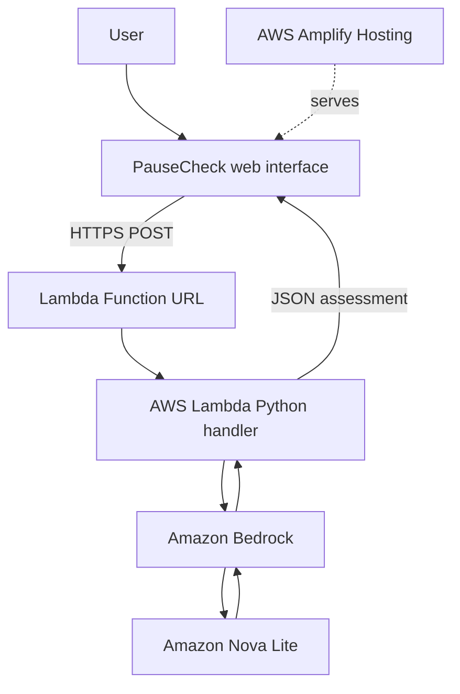

# PauseCheck 🛡️

**Think before you click.**

PauseCheck is an AI-powered suspicious-message checker built to help people recognize potential phishing attempts, understand warning signs, and choose safer next steps.

## Live Demo

**Try PauseCheck:** https://staging.d2hbt51e58u87x.amplifyapp.com

## Why PauseCheck?

Suspicious messages often rely on urgency, impersonation, fake rewards, suspicious links, or requests for sensitive information. PauseCheck lets users submit a message and receive an AI-generated assessment with practical guidance.

## Features

- AI-powered message assessment
- Risk level: High, Medium, Low, or Unclear
- Summary explaining the assessment
- List of potential warning signs
- Recommended safer next steps
- Simple browser-based interface

## Built With

- **Frontend:** HTML, CSS, JavaScript
- **Hosting:** AWS Amplify Hosting
- **Backend:** AWS Lambda (Python)
- **API entry point:** AWS Lambda Function URL
- **Generative AI:** Amazon Bedrock with Amazon Nova Lite

## Architecture



For more detail, see [`docs/architecture.md`](docs/architecture.md).

## Repository Structure

```text
pausecheck/
├── frontend/
│   └── index.html
├── backend/
│   └── lambda_function.py
├── docs/
│   └── architecture.md
├── .gitignore
└── README.md
```

## How It Works

1. The user enters a suspicious message in the web interface.
2. The frontend sends the message to the Lambda Function URL.
3. Lambda validates the request and invokes Amazon Bedrock.
4. The model returns a structured assessment.
5. Lambda returns JSON to the frontend.
6. PauseCheck displays the risk level, summary, warning signs, and safer actions.

## Running and Deployment Notes

The frontend is a static HTML application and can be hosted with AWS Amplify Hosting. The backend is designed to run as an AWS Lambda function with a Function URL.

The backend requires permission to invoke the configured Amazon Bedrock model. Its default region is `us-east-1`, and its default model ID is `amazon.nova-lite-v1:0`; these can be configured using the `AWS_REGION` and `BEDROCK_MODEL_ID` environment variables.

Before deploying your own instance, update the API URL in the frontend to point to your own Lambda Function URL and configure the Function URL CORS settings to allow the frontend origin.

## Security and Responsible Use

- **Never commit credentials, access keys, API keys, or secrets.**
- Do not submit passwords, one-time passcodes (OTPs), payment information, or other sensitive personal data.
- A risk assessment is informational and is not a guarantee that a message is safe or fraudulent.
- Verify important requests independently through trusted official channels.
- A public Lambda Function URL can be invoked by external callers. Review permissions, abuse controls, and potential AWS usage costs before operating at scale.

## Current Scope

PauseCheck focuses on text-based suspicious-message analysis and practical guidance. Multilingual analysis, expanded evaluation, and additional privacy safeguards may be considered as future enhancements; they should not be treated as existing features unless implemented.

## License

No license has been added yet. Add an appropriate open-source license before permitting reuse or redistribution.

---

Built as a practical demonstration of generative AI and serverless application development on AWS.

#AWS #AmazonBedrock #AWSLambda #AWSAmplify #GenerativeAI #agents
