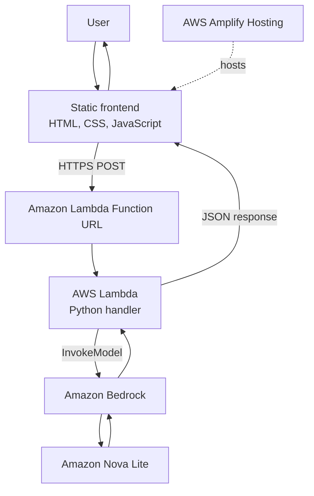

# PauseCheck Architecture

## Overview

PauseCheck is an AI-powered suspicious-message checker. A user submits a message through the web interface and receives a structured assessment containing a risk level, a short explanation, warning signs, and safer next steps.

## Architecture Diagram

## Components

### 1. Frontend — HTML, CSS, and JavaScript

The browser-based interface allows users to enter a suspicious message and request an assessment. It displays the returned risk level, summary, red flags, and safe actions.

### 2. Hosting — AWS Amplify

AWS Amplify Hosting serves the static frontend and provides a public HTTPS URL.

Live demo: https://staging.d2hbt51e58u87x.amplifyapp.com

### 3. API entry point — Lambda Function URL

The frontend sends an HTTPS POST request to the Lambda Function URL. The Function URL is configured for public invocation and CORS. CORS headers are configured at the Function URL level; the Lambda handler should not add duplicate `Access-Control-Allow-*` headers.

### 4. Backend — AWS Lambda

The Python Lambda handler parses and validates the submitted message, calls Amazon Bedrock, and returns a JSON response to the frontend. The expected response fields are:

- `risk_level` — `High`, `Medium`, `Low`, or `Unclear`
- `summary` — brief explanation of the assessment
- `red_flags` — list of potential warning signs
- `safe_actions` — list of recommended safer next steps

### 5. AI inference — Amazon Bedrock and Amazon Nova Lite

The Lambda function invokes the configured Amazon Bedrock model to assess the submitted message. The model is instructed to return structured JSON suitable for display in the frontend.

## Request Flow

1. The user enters a message in the PauseCheck interface.
2. The frontend sends the message to the Lambda Function URL over HTTPS.
3. Lambda validates the request body.
4. Lambda invokes Amazon Bedrock using the configured model.
5. The model returns a structured assessment.
6. Lambda returns the assessment as JSON.
7. The frontend displays the risk level, summary, red flags, and safe actions.

## Security and Limitations

- Do not commit AWS credentials, access keys, API keys, or other secrets to this repository.
- Public Function URL access means the endpoint can be invoked by external callers; review access controls and usage costs before operating the app at scale.
- Do not submit passwords, one-time passcodes (OTPs), payment details, or other sensitive personal information.
- PauseCheck provides an informational assessment, not guaranteed scam detection. Users should independently verify important requests through trusted official channels.
- The frontend and backend should be kept in sync when changing request fields or response structure.

## Configuration Notes

The backend uses the `AWS_REGION` environment variable when available and defaults to `us-east-1`. It uses `BEDROCK_MODEL_ID` when set and otherwise defaults to `amazon.nova-lite-v1:0`.

The architecture document describes the current intended flow. It is documentation, not an infrastructure-as-code deployment template.
